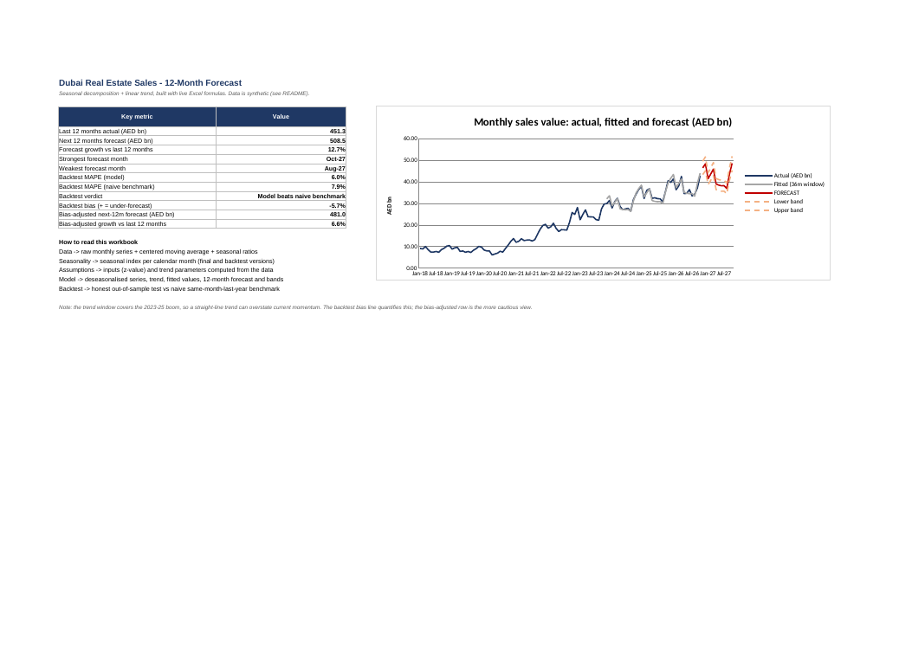

# Dubai Real Estate Analytics: Excel Forecasting + SQL Business Analysis

Two portfolio projects for a **Business Analyst** role, built around the Dubai property market:

| # | Project | Tools | Question answered |
|---|---------|-------|-------------------|
| 1 | **Time-series forecast** of monthly Dubai sales value | Excel (formulas only, no macros) | What will market sales look like over the next 12 months, and how reliable is the forecast? |
| 2 | **Brokerage revenue analysis** of 6,000 deals | SQL (SQLite; window functions, CTEs) | Where does a brokerage earn its revenue, and what should management change? |

> **Data disclaimer:** all data here is **synthetic** (generated by `data/generate_data.py`) so the project runs
> anywhere. It is *not* real market data. To use real data, see [Using real data](#using-real-data).



## Repository structure
```
dubai-real-estate-analytics/
├── README.md
├── requirements.txt            # only needed to regenerate data / rebuild the workbook
├── data/
│   ├── generate_data.py        # creates the synthetic CSVs (seeded, reproducible)
│   ├── monthly_sales.csv       # 106 months, Jan 2018 - Oct 2026   (Excel project)
│   ├── transactions.csv        # 6,000 deals, 2023 - 2026          (SQL project)
│   ├── agents.csv  areas.csv   # dimension tables
├── excel/
│   ├── Dubai_Sales_Forecast.xlsx   # the deliverable (open this)
│   └── build_forecast.py           # script that generated the workbook
├── sql/
│   ├── 01_schema.sql               # tables, constraints, indexes, view
│   ├── 02_data_quality_checks.sql  # 6 checks that must pass before analysis
│   ├── 03_analysis_queries.sql     # 14 business questions
│   ├── run_analysis.py             # builds the DB and runs everything
│   └── results/                    # CSV output of every query
└── docs/
    ├── business_recommendations.md # findings -> decisions (read this)
    └── forecast_summary.png
```

---

## Project 1: Excel time-series forecast

**Method: classical multiplicative decomposition, every step a live formula (1,600+ formulas, 0 errors):**
1. Centered 12-month moving average → trend-cycle (`Data` sheet)
2. Actual ÷ moving average → seasonal ratios; averaged by calendar month and normalised to mean 1.00 (`Seasonality`)
3. Deseasonalise, fit a linear trend with `SLOPE`/`INTERCEPT` on the latest 36 months (`Assumptions`, `Model`)
4. Forecast = trend × seasonal index for the next 12 months, with a ±1.96 × residual-SD band
5. **Backtest** (`Backtest` sheet): re-fit using only data up to 12 months ago, predict the last 12, and compare against a naive "same month last year" benchmark

**Results (synthetic data):** the model's backtest error (MAPE) was **6.0% vs 7.9% for the naive benchmark**, so it adds value.
The backtest also showed it **over-forecasts** (bias -5.7%) because growth is slowing, so the Summary sheet shows both the raw (+12.7%) and bias-adjusted (+6.6%) 12-month outlook. Reporting a model's weakness alongside its forecast is deliberate.

**Why not Excel's built-in `FORECAST.ETS`?** It is a black box. Building the decomposition by hand shows I understand trend, seasonality and out-of-sample validation. (Mention `Data → Forecast Sheet` as the quick alternative in interviews.)

## Project 2: SQL business analysis

```bash
python sql/run_analysis.py      # needs Python 3 only (standard library); builds dubai_brokerage.db
```
Creates the database, runs the 6 data-quality checks (stops if any fail), then runs 14 queries and writes each result to `sql/results/*.csv`.

| Query | Business question | Techniques |
|---|---|---|
| q01 | KPI overview | aggregates |
| q02-q03 | Yearly (like-for-like YTD) and monthly trend | `LAG`, moving average window |
| q04 | Seasonality | CTE, sub-query index |
| q05 | Revenue by area + concentration | `RANK`, running % with `SUM() OVER` |
| q06 | Off-plan vs secondary economics | window share-of-total, revenue per deal-day |
| q07-q08 | Lead channels; resident vs non-resident buyers | conditional aggregation |
| q09-q11 | Agent leaderboard, Pareto (80/20), top agent per team | `NTILE`, `ROW_NUMBER … PARTITION BY`, cumulative share |
| q12 | Price/sqft growth by area | pivot with `CASE` |
| q13 | Agent ramp-up by tenure | **recursive CTE** calendar, revenue per agent-*month* |
| q14 | Slow-closing segments | multi-column group + threshold % |

**Findings and recommended actions → [`docs/business_recommendations.md`](docs/business_recommendations.md).**

---

## How to do this online (no installation)

### A. Excel project in the browser
- Upload `Dubai_Sales_Forecast.xlsx` to **Excel for the web** (OneDrive) or **Google Sheets** (File → Import). All formulas are standard (`SLOPE`, `AVERAGEIFS`, `INDEX`, `EDATE`) and work in both.
- To build it yourself from scratch: paste `monthly_sales.csv` into a sheet, then follow the 5 steps above one column at a time.

### B. SQL project in the browser
- Use any online SQLite playground (e.g. SQLite Online, DB Fiddle): paste `01_schema.sql`, import the three CSVs, then paste queries from `03_analysis_queries.sql` one at a time.
- Alternatively, open the repo in **GitHub Codespaces** (green *Code* button → Codespaces) and run `python sql/run_analysis.py` in the browser terminal.
- Window functions need **SQLite 3.25+**. For MySQL 8 / PostgreSQL: replace `strftime`/`julianday`/`printf` with `DATE_FORMAT`/`DATEDIFF`/`TO_CHAR`, and `date(m,'+1 month')` with `m + INTERVAL '1 month'`; the rest is standard SQL.

### C. Upload to GitHub (web only, no Git needed)
1. Sign up / log in at **github.com**.
2. Click **+** (top right) → **New repository**. Name it `dubai-real-estate-analytics`, set **Public**, tick *Add a README* (you will overwrite it), click **Create repository**.
3. **Unzip** this project on your computer first (GitHub cannot unpack zips).
4. In your new repo click **Add file → Upload files**, then drag in **all folders and files** (`data`, `excel`, `sql`, `docs`, `README.md`, `requirements.txt`, `.gitignore`). Browser upload limit is 100 files per batch and 25 MB per file; this project is well under both.
5. Scroll down, write a commit message (e.g. `Add Excel forecast and SQL analysis projects`), click **Commit changes**.
6. Check that the README renders with the image. On the repo page click the ⚙ next to *About*, add a one-line description and topics: `data-analysis`, `sql`, `excel`, `forecasting`, `real-estate`, `dubai`, `business-analyst`.
7. Put the repo link on your CV and LinkedIn *Featured* section.

### D. Upload with Git (command line, optional)
```bash
cd dubai-real-estate-analytics
git init
git add .
git commit -m "Add Excel forecast and SQL analysis projects"
git branch -M main
git remote add origin https://github.com/<your-username>/dubai-real-estate-analytics.git
git push -u origin main
```
(Create the empty repo on GitHub first, without a README, to avoid a merge conflict.)

---

## Using real data
- **Dubai Land Department transactions** are published as open data on [Dubai Pulse](https://www.dubaipulse.gov.ae/organisation/dld/service/dld-transactions).
- *Excel project:* aggregate to monthly total sales value, replace columns A-D on the `Data` sheet, extend ranges if the series is longer, then check the `Backtest` verdict.
- *SQL project:* map the real columns to `transactions` (see `01_schema.sql`). Real data has no commission or agent fields, so use `price_aed` as the measure or join your own company data. Rerun `02_data_quality_checks.sql` first; real data will fail some checks, and that is part of the analysis.

## Talking points for an interview
- *"Why did you build the forecast by hand?"* To show I understand decomposition and can validate a model out-of-sample, not just click a button.
- *"What went wrong?"* The backtest showed a consistent over-forecast from decelerating growth, so I reported a bias-adjusted figure beside the raw one.
- *"What did the SQL tell you?"* Off-plan drives 75% of revenue at about 4x the revenue per deal-day, and 6 of 20 agents produce half of it. It also showed no channel or area differences, and I said so rather than forcing a story.
- *"Any pitfall you avoided?"* Comparing partial-year 2026 to full-year 2025 (fixed with like-for-like YTD) and a tenure analysis that ignored exposure time (fixed by using revenue per agent-month).

*Built as a portfolio project; synthetic data; not investment or market advice.*
